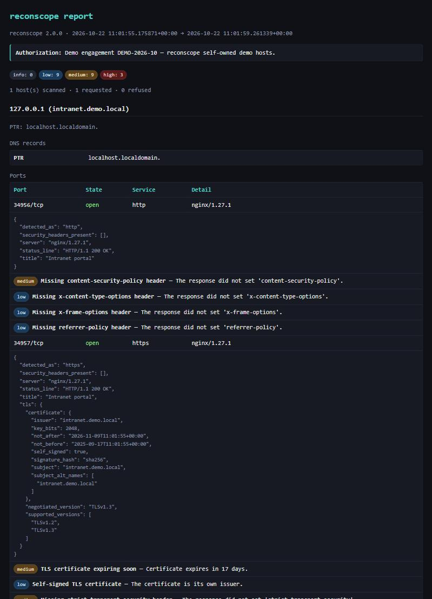

# reconscope

Scope-bounded network and service enumeration for **authorized** security assessments.

`reconscope` discovers hosts and services on networks you are permitted to test, identifies
each service by what it actually speaks, and reports the hygiene issues a defender cares about
— deprecated TLS versions and weak certificates, missing HTTP security headers, weak SSH
algorithms, legacy SMBv1, unauthenticated Redis, databases without TLS, VNC with no password —
as a JSON file and a self-contained HTML report. Discoveries chain: names found in certificates,
redirects and DNS records are scanned in turn, within the authorized scope.

Its distinguishing feature is the **scope file**: a required allow-list of hosts and ports.
`reconscope` refuses to send a single packet to anything the scope does not explicitly
authorize, and it records every refusal in the report.

> ### Authorized use only
> This is a tool for assessing systems you own or have **explicit written permission** to test.
> Port-scanning or enumerating hosts without authorization is illegal in many jurisdictions.
> The scope file is a safety boundary, not a substitute for that permission. You are
> responsible for staying within the scope of your engagement.



## Highlights

- **Fail-closed scope gate.** A YAML scope file lists the hosts and ports in scope; an
  `authorization` note is mandatory. Targets are authorized twice — once on the name or address
  you give, and again on every address it resolves to — so a hijacked DNS answer cannot pull an
  unlisted host into scope. [`src/reconscope/scope.py`](src/reconscope/scope.py)
- **Asynchronous TCP connect scan**, with hosts scanned concurrently and a combined
  concurrency + requests-per-second rate limiter, so scans are fast but stay gentle on the
  target and on the network in between.
- **Port-independent service detection.** Each open port is identified by *what it speaks*, not
  by its number: the scanner reads what the service greets with, then actively (but gently)
  probes — a TLS handshake, an HTTP request, then the client-first binary protocols — so it
  recognises HTTP on 8081, a database moved off its default port, or TLS wrapping anything.
  [`src/reconscope/detect.py`](src/reconscope/detect.py)
- **Recon chaining.** Host names found in TLS certificate SANs, HTTP redirects and DNS records
  are fed back through the scope gate; the in-scope ones are resolved and scanned in turn, so
  one discovery leads to the next — always within the authorized scope.
- **Read-only protocol probes** — 13 of them. Each identifies a service and flags hygiene
  issues without authenticating, changing state or transferring files:
  - **HTTP(S)** — status, title, `Server`, and missing security headers (HSTS, CSP, …).
  - **TLS** — certificate subject/issuer/SAN/expiry, key size and signature, plus which
    protocol versions are accepted (flags TLS 1.0/1.1 and self-signed, expired or weak certs).
  - **SSH** — the offered key-exchange, host-key, cipher and MAC algorithms, with deprecated
    ones flagged (SHA-1 KEX, CBC ciphers, `ssh-rsa`, …).
  - **SMB** — negotiated dialect, whether signing is required, and whether the obsolete SMBv1
    protocol is still enabled.
  - **FTP / SMTP** — banner and capabilities, flagging the absence of `AUTH TLS` / `STARTTLS`.
  - **Telnet** — presence (clear-text remote access is itself the finding).
  - **Redis** — detects an instance reachable with **no authentication** (a serious exposure).
  - **MySQL / PostgreSQL** — version and whether the server can negotiate TLS, from the
    pre-authentication handshake.
  - **VNC** — the offered RFB security types, flagging `None` (no password).
  - **RDP** — the negotiated security protocol, flagging legacy standard RDP (no TLS/NLA).
  - **DNS** — forward records for a name, reverse PTR for an address.
- **Hardened HTML report.** All collected values are HTML-escaped and the page carries a
  Content Security Policy that forbids scripts and remote resources; its one inline stylesheet
  is allowed by its SHA-256 hash, so a hostile banner or certificate field cannot inject markup.
- **Pure-Python probes.** The SSH, SMB, MySQL, PostgreSQL, VNC and RDP probes speak their
  protocols directly over `asyncio` sockets; the only runtime dependencies are `pyyaml`,
  `jinja2`, `dnspython` and `cryptography`.

## Install

```bash
git clone https://github.com/Barkatzineddine/reconscope.git
cd reconscope
python -m pip install --require-hashes --no-deps -r requirements-dev.txt
python -m pip install --no-deps --no-build-isolation -e .
```

Requires Python 3.12+. The locked `requirements*.txt` are compiled with hashes (see
[Dependencies](#dependencies)); for a plain install, `pip install .` works too.

## The scope file

The scope file is the authorization boundary. A minimal example
([`examples/scope.example.yml`](examples/scope.example.yml)):

```yaml
authorization: "Engagement ACME-2026-07 — written permission on file."

allow:
  hosts:
    - 192.0.2.0/24          # a network (CIDR)
    - 198.51.100.10         # a single address
    - app.staging.acme.test # a host, authorized by name
  ports:
    - 22
    - 80
    - 443
    - 445
    - 8080

deny:
  hosts:
    - 192.0.2.1             # inside the network above, but never touch it

rate:
  max_concurrency: 50       # at most this many connections open at once
  requests_per_second: 20   # and at most this many new connections per second
```

Rules the gate enforces:

- `authorization` must be present — `reconscope` refuses to run without it.
- An address target must fall inside an allowed network; a name target must be listed by name.
- A `deny` entry always wins over an `allow` entry.
- A name that resolves to an address outside the allowed networks is refused.

## Usage

Review what a scope authorizes, without touching the network:

```bash
reconscope validate-scope examples/scope.example.yml
```

Run a scan (defaults to every host in the scope; or pass explicit in-scope targets):

```bash
reconscope scan --scope examples/scope.example.yml --json report.json --html report.html
reconscope scan --scope examples/scope.example.yml 192.0.2.10 app.staging.acme.test
```

With no `--json`/`--html`, the JSON report is printed to standard output. A one-line summary
(host count and finding counts by severity) is always written to standard error.

## The test lab

[`lab/`](lab) is a `docker-compose` network of deliberately imperfect services — nginx with a
self-signed certificate and no security headers, an SSH server offering deprecated algorithms,
a Samba server with SMBv1 enabled, a password-less Redis, and a CoreDNS zone. CI brings the lab
up and scans it on every push, asserting that each planted issue is reported
([`lab/check_report.py`](lab/check_report.py)). To run it yourself:

```bash
cd lab
docker compose -p reconscopelab up -d --build
docker run --rm --network reconscopelab_lab -v "$PWD/..":/app -w /app python:3.12-slim bash -c '
  pip install --require-hashes --no-deps -r requirements-dev.txt &&
  pip install --no-deps --no-build-isolation -e . &&
  reconscope scan --scope lab/scope.lab.test.yml --json report.json --html report.html \
    10.13.37.10 10.13.37.20 10.13.37.30 10.13.37.40 10.13.37.50'
python lab/check_report.py report.json
docker compose -p reconscopelab down -v
```

## Development

```bash
ruff check .          # lint
ruff format --check . # formatting
mypy                  # type check (strict)
pytest --cov          # tests, with a 90% coverage gate
```

The test suite spins up real local TCP/TLS servers on loopback, so the probes are exercised
against genuine sockets rather than mocks.

## Security posture

- **Dependencies** are pinned with hashes in `requirements.txt` / `requirements-dev.txt`,
  compiled by `uv pip compile --generate-hashes --exclude-newer` (a 7-day cooldown, matched by
  Dependabot) so a freshly published malicious version is never pulled in. CI installs with
  `pip --require-hashes` and audits with `pip-audit`.
- **GitHub Actions** are pinned to a commit SHA; the Gitleaks scanner runs from a
  digest-pinned image.
- **Scanning:** CodeQL (`security-extended`), Gitleaks secret scanning and OpenSSF Scorecard
  run in CI.
- See [SECURITY.md](SECURITY.md) for how to report a vulnerability.

## Dependencies

Runtime: `pyyaml`, `jinja2`, `dnspython`, `cryptography`. Re-lock with:

```bash
uv pip compile requirements.in --universal --python-version 3.12 \
  --generate-hashes --exclude-newer "$(date -d '-7 days' +%F)" -o requirements.txt
```

## License

[MIT](LICENSE) © Mohamed Zineddine Barkat
